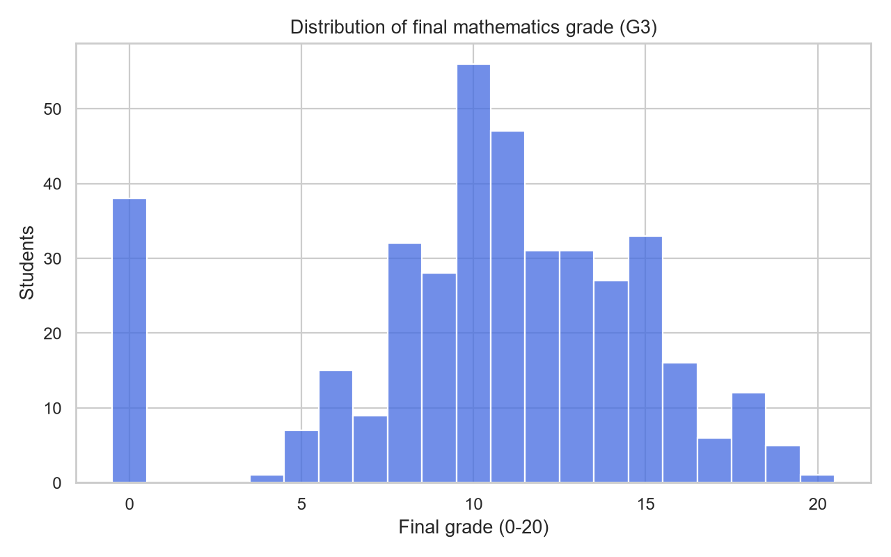
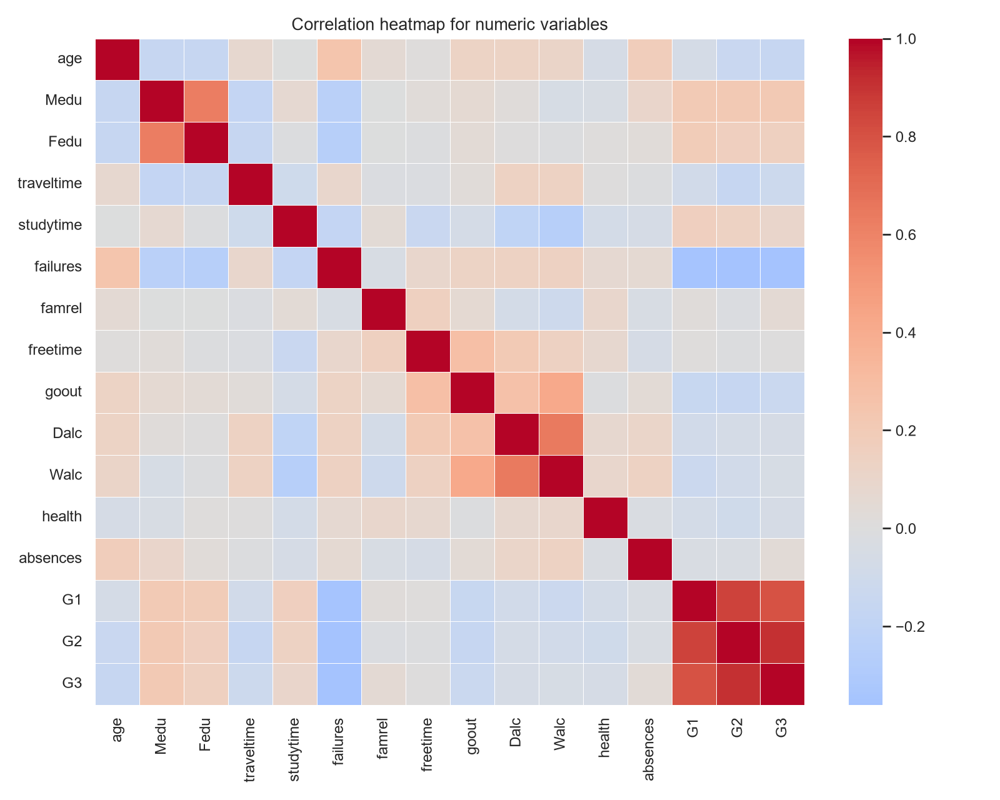
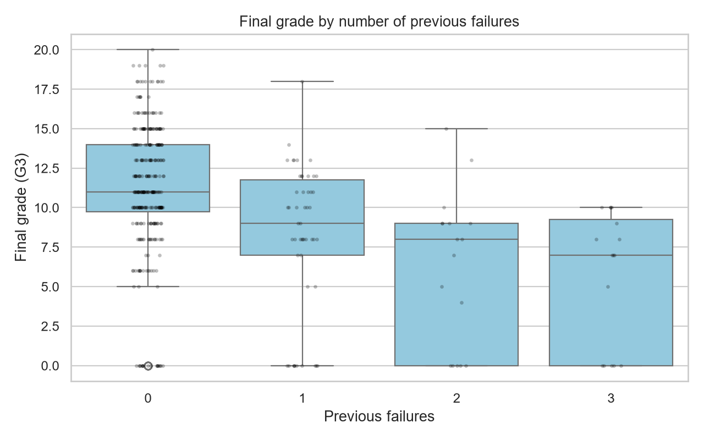
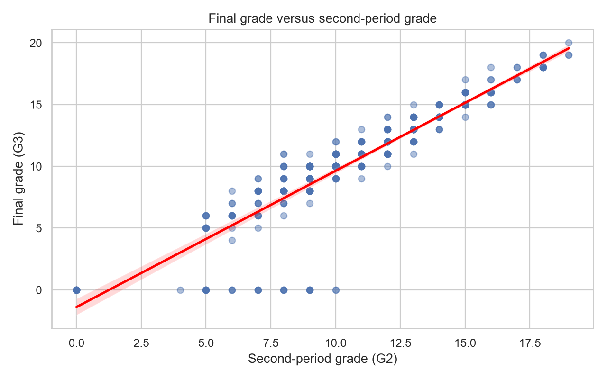

# Data understanding and EDA evidence

## Dataset definition

| Item | Evidence |
|---|---|
| Source | [UCI Student Performance dataset](https://archive.ics.uci.edu/dataset/320/student+performance) |
| File used | `data/student-mat.csv` |
| Unit of analysis | One student enrolled in a mathematics course |
| Rows / columns | 395 / 33 |
| Delimiter | Semicolon (`;`) |
| SHA-256 fingerprint | `E47F9EE225E1EE6E69B7564E6DAC7123E80B8486677FE111F351964CEF5DEC80` |
| Target | `G3`, final mathematics grade from 0 to 20 |
| Missing cells | 0 |
| Duplicate rows | 0 |
| Zero final grades | 38 |

The dataset is used for an **end-of-term prediction scenario** when `G1` and
`G2` are available. A separate early-intervention run excludes `G1`, `G2`,
and the engineered `grade_progress` feature; it should not be described as
the same prediction task.

## Data dictionary

| Variables | Type in source | Meaning |
|---|---|---|
| `school`, `sex`, `address`, `famsize`, `Pstatus` | Nominal | School, sex, urban/rural address, family size, parent cohabitation |
| `Mjob`, `Fjob`, `reason`, `guardian` | Nominal | Mother/father job, reason for school choice, primary guardian |
| `schoolsup`, `famsup`, `paid`, `activities`, `nursery`, `higher`, `internet`, `romantic` | Binary categorical | Support, paid classes, activities, nursery, higher-education intention, internet, relationship |
| `age` | Numeric | Student age |
| `Medu`, `Fedu` | Ordinal (0-4) | Mother/father education level |
| `traveltime` | Ordinal (1-4) | Travel time to school |
| `studytime` | Ordinal (1-4) | Weekly study time |
| `failures` | Ordinal/count (0-3) | Past class failures; 3 means three or more |
| `famrel`, `freetime`, `goout`, `Dalc`, `Walc`, `health` | Ordinal (1-5) | Family relationship, free time, going out, workday/weekend alcohol use, health |
| `absences` | Count | Number of school absences |
| `G1`, `G2` | Grade (0-20) | First- and second-period grades |
| `G3` | Grade (0-20) | Final mathematics grade and prediction target |

## EDA findings

The reproducible generator is
[`eda_analysis.py`](eda_analysis.py). It writes the figures and CSV/JSON
evidence to [`outputs/`](outputs/).

| Finding | Observed evidence | Interpretation |
|---|---:|---|
| Final-grade variation | Mean 10.415; standard deviation 4.581 | There is enough variation for a regression task |
| Strongest numeric association | `G2`–`G3` correlation 0.905 | End-of-term predictions are strongly informed by the second-period grade |
| First-period association | `G1`–`G3` correlation 0.801 | Earlier grade information is useful but weaker than `G2` |
| Previous failures | Correlation with `G3` = -0.360 | Students with more failures tend to have lower final grades |
| Failure-group means | 11.253 (0), 8.120 (1), 6.235 (2), 5.688 (3) | Failures are a meaningful risk indicator, not a causal explanation |
| Study time | Means range from 10.048 to 11.400 | The relationship is weaker and not monotonic; avoid overstating it |
| Absences | Correlation with `G3` = 0.034 | Absences alone are weak in this sample |

